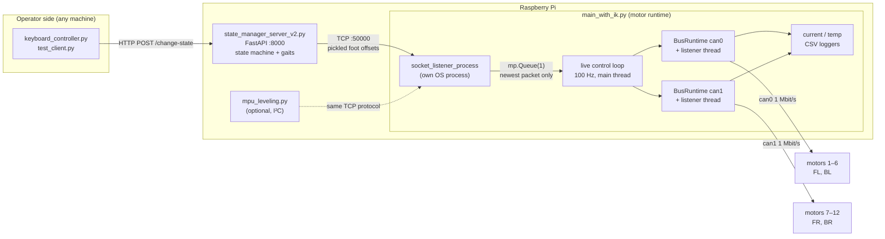
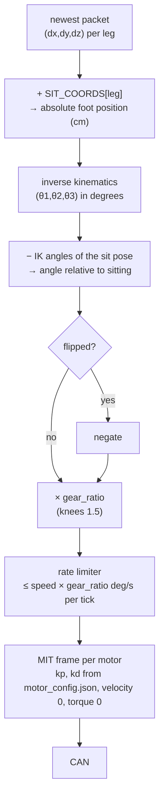
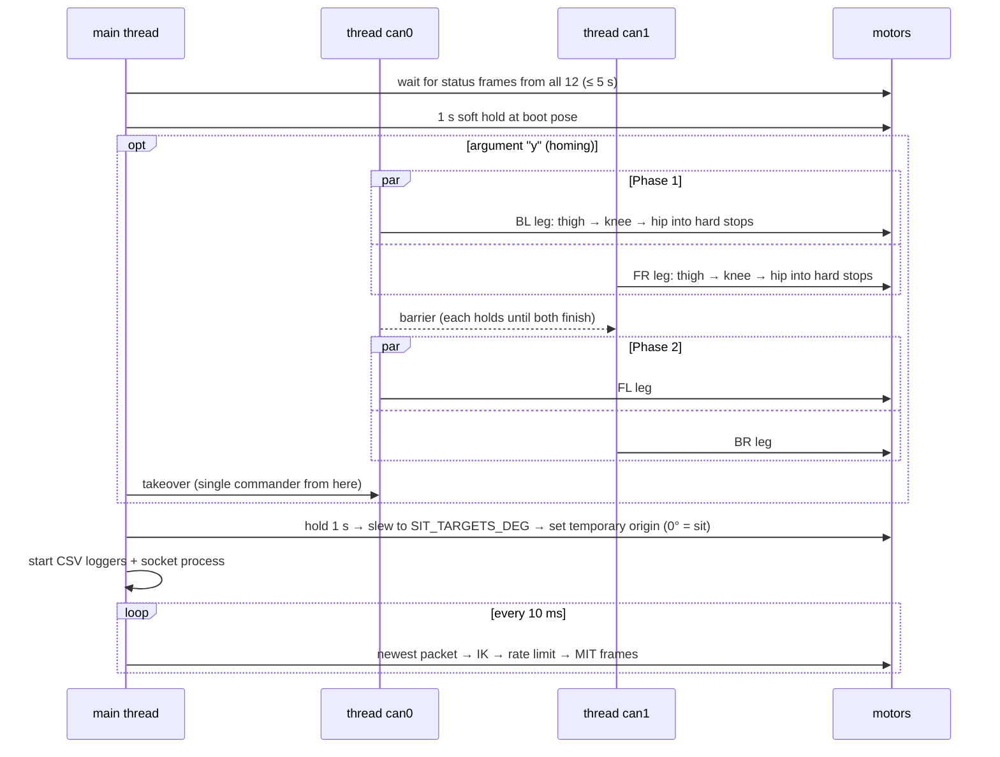

# Architecture

How BYTE-01's software is put together, from a keypress down to CAN frames.
Everything described here lives in [`robot/`](../robot/); file-by-file detail is
in [`CODE_MAP.md`](CODE_MAP.md).

## 1. The big picture



Three programs cooperate, each doing one job:

| Program | Job | Knows about | Does **not** know about |
|---|---|---|---|
| `state_manager_server_v2.py` | Turn *intents* ("FORWARD") into a stream of foot positions | gaits, timing, HTTP | motors, CAN, IK |
| `main_with_ik.py` | Turn foot positions into motor commands, safely | IK, gear ratios, limits, CAN | gaits, HTTP |
| `lib/*` | Reusable pieces: driver, bus runtime, homing, IK, gait maths | their own domain | each other's callers |

This separation is the main design idea: **you can replace the walking logic
without touching motor safety, and vice-versa.** The only contract between the
two programs is the packet in §3.

## 2. Software layers

```
┌───────────────────────────────────────────────────────────────────────────┐
│ clients      keyboard_controller · test_client · (web UI / gamepad / voice)│  intent
├───────────────────────────────────────────────────────────────────────────┤
│ behaviour    state_manager_server_v2  ── lib/trot_gait.py                 │  gaits
├──────────────────────────  TCP :50000, pickled dict  ─────────────────────┤
│ runtime      main_with_ik.py   (live loop, rate limiter, shutdown)        │  safety
├───────────────────────────────────────────────────────────────────────────┤
│ kinematics   lib/inverse_kinematics.py  (+ config/robot_config.py)        │  maths
│ homing       lib/homing_controller.py                                     │
│ bus runtime  lib/can_runtime.py  (state, listener, watchdogs, faults)     │
├───────────────────────────────────────────────────────────────────────────┤
│ driver       lib/ak60_v3_control.py   (MIT frames, status decode)         │  wire
├───────────────────────────────────────────────────────────────────────────┤
│ OS / HW      SocketCAN can0 / can1 · MCP2515 · 12 × AK60-6 V3.0           │
└───────────────────────────────────────────────────────────────────────────┘
```

Rule of thumb: **a layer only calls the one directly below it.** `main_with_ik`
never builds a CAN frame; the driver never knows what a leg is.

## 3. The packet protocol (the contract between behaviour and runtime)

One TCP connection per packet — connect, send, close. Payload is
`pickle.dumps` of:

```python
{
  "fl": [dx, dy, dz],   # front-left  foot offset, cm, from the SITTING pose
  "bl": [dx, dy, dz],   # back-left
  "fr": [dx, dy, dz],   # front-right
  "br": [dx, dy, dz],   # back-right
  "speed": 400.0,       # OPTIONAL joint speed limit, deg/s (default 120)
}
```

* All four legs are mandatory; the runtime drops malformed packets and keeps going.
* Values are **absolute offsets from `SIT_COORDS`**, not increments: `0,0,0` is
  "sit", `dz = −14` is "stand". The state manager keeps the running pose and
  sends it each tick.
* Only the **newest** packet matters. The hand-off queue has length 1 and stale
  packets are discarded, so a slow runtime can never build a backlog.
* `speed` persists until the next packet changes it. Gaits send 500 deg/s;
  static poses use the default 120 deg/s, which produces the slow, gentle
  sit ⇄ stand transitions.

> ⚠ The payload is a *pickle*. See [KNOWN_ISSUES §S2](KNOWN_ISSUES.md).

Other message shapes that exist: `tests/joint_sender.py` sends
`{motor_id: angle_deg, "speed": …}` to `tests/joint_tester.py` (a separate
raw-joint runtime for bench work); it is not understood by `main_with_ik.py`.

## 4. From foot position to motor torque

What happens every 10 ms inside `run_post_homing_live_control`:



**Why "relative to the sit pose"?** At start-up every motor is driven to the
sitting angles (`SIT_TARGETS_DEG`) and then *re-zeroed there*. After that, motor
angle 0 = sitting, so the IK output must be expressed relative to the IK angles
of `SIT_COORDS`. The two tables in `config/robot_config.py` therefore describe
the **same physical pose** in two ways and must be kept consistent.

**What the motor does with the frame** (MIT mode, evaluated inside the motor):

```
torque = kp · (target_angle − angle) + kd · (0 − speed) + 0
```

i.e. a spring-damper pulling toward the target. `kp ≈ 300–400`, `kd ≈ 1.5`
(`config/motor_config.json`). The rate limiter is what keeps the spring target
moving smoothly; the spring itself is only as stiff as `kp`.

### Coordinate frames

```
              +Z (up)
               │      +X (forward)
               │    ╱
               │  ╱
               │╱______ +Y (right)
```

Origin at each leg's hip. Left legs have negative Y at rest (`SIT_COORDS`), which
is how `+Y = right` was determined (older comments in a few gait files still say
"+Y left"; see KNOWN_ISSUES F4).

### Leg model

Three revolute joints; link lengths in cm: `L1 = 5.995` (fore-aft hip offset),
`Lc = 9.094` (lateral offset of the thigh plane), `L2 = 22.0` (thigh),
`L3 = 21.5` (shank). Forward kinematics:

```
Le = L2·cosθ2 + L3·cos(θ2+θ3)         X = −L1 − Le
Lp = L2·sinθ2 + L3·sin(θ2+θ3)         Y =  Lc·cosθ1 + Lp·sinθ1
                                      Z = −Lc·sinθ1 + Lp·cosθ1
```

The IK inverts this analytically (closed form, no iteration): θ1 from the
tangent to the `Lc` cylinder, θ2/θ3 from the planar two-link solution. It was
checked numerically: `FK(IK(p)) − p` is below 1e-13 cm on sit/stand-range
targets, and `IK(SIT_COORDS)` minus the sit reference is exactly 0 for all legs.

## 5. Threads, processes and who owns what

| Name | Kind | Rate | Responsibility |
|---|---|---|---|
| main thread | thread | 100 Hz | homing coordination → sit/zero → live loop → shutdown |
| `socket_listener_process` | **process** | event | accept TCP, un-pickle, validate, put on queue |
| `controller_thread_entry` ×2 | threads | 100 Hz | homing, one per CAN bus, only while homing |
| python-can `Notifier` ×2 | threads | event | decode status frames into `MotorState` |
| `CurrentLogger`, `TempLogger` | threads | 5 Hz | write `robot/logs/*.csv` |
| state server | asyncio loop | 100 Hz while gaiting | HTTP + gait ticks |

The socket reader is a separate **process** so that network I/O and un-pickling
can never stall the 100 Hz motor loop (Python's GIL would otherwise couple them).

Shared state is confined to `BusRuntime.states` behind one re-entrant lock;
readers get **deep copies**, so no consumer ever sees a half-updated motor.

## 6. Start-up sequence



Homing detail (what "drive into a hard stop" means) is in the module docstring of
`robot/lib/homing_controller.py`: profiled approach → slow creep → current
spike *latches* contact → confirmed by sustained current or stall → temporary
zero → back off to a known pose.

## 7. Safety model

| Layer | Mechanism | Effect |
|---|---|---|
| Driver | all MIT inputs clamped to the motor's ranges | no out-of-range frames |
| Runtime | slew-rate limiter on every motor | no joint can be commanded faster than `speed × gear` deg/s |
| Runtime | `validate_leg_payload` | malformed packets dropped, loop continues |
| Bus | per-motor stale-feedback watchdog (0.15 s) | latched fault → all motors disabled |
| Bus | whole-bus silence watchdog (0.40 s), BUS-OFF, listener death | latched fault |
| Motor | any non-zero error byte (over-temp, over-current, …) | latched fault |
| Homing | `max_search_travel_deg` (220°), contact latch + confirmation | aborts runaway search |
| Shutdown | `finally:` always runs `disable_all()` | motors go limp |

Faults are **latched and fatal by design**: the response to *anything*
unexpected is "stop commanding, go limp". The corollary is that the robot
collapses when that happens — see KNOWN_ISSUES R1/R2.

## 8. Extending it

* **New behaviour (a gait, a gamepad, a web UI):** write a client that sends the §3
  packet. You never need to touch `main_with_ik.py`. The stateless engine in
  `lib/trot_gait_lib.py` is a good template — it computes targets from absolute
  positions and cannot drift if a tick is dropped.
* **New static pose:** add an entry to `static_states` in the state manager.
* **Tuning a joint:** edit `config/motor_config.json` (kp/kd/flip/gear) — no code.
* **Different sit pose:** change `SIT_COORDS` **and** `SIT_TARGETS_DEG` together.
* **Different network:** edit `SOCKET_HOST` in `config/robot_config.py`.
